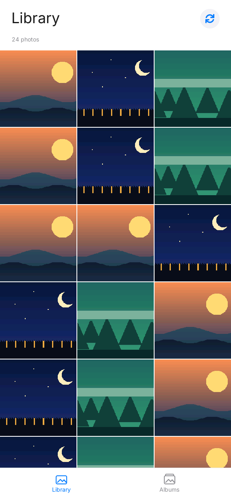
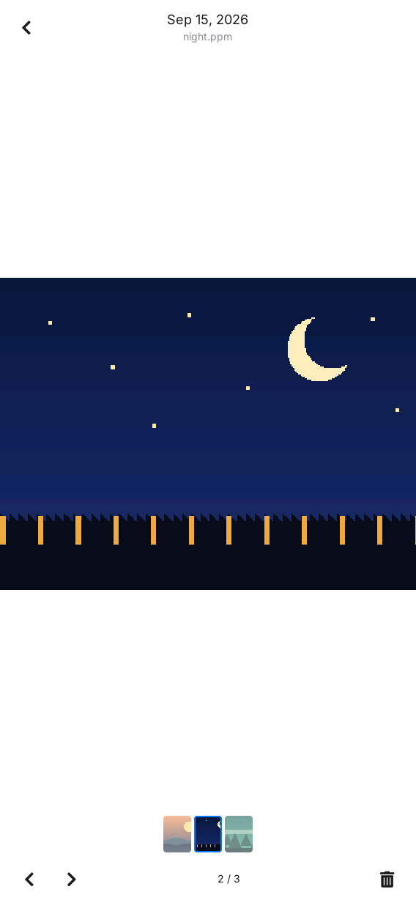

# LILYGO UI Gallery

**English** | [简体中文](README.zh-CN.md)

LILYGO UI Gallery is a standalone photo and video browser for LILYGO UI, built with C++17,
[LILYGO UI AppKit](https://github.com/LILYGO-UI/cm0-appkit) and LVGL 9.5.
It browses camera photos, MP4 recordings, screenshots, and bundled samples with an
iOS Photos-inspired interface, keeping filesystem state, presentation state,
and widgets in separate Model, ViewModel, and View layers.

The project provides a CM0 ARM64 Linux build and an SDL2 desktop simulator
for development and testing.

## Preview

<p>
  
  
</p>

More portrait and landscape screens are in [`assets/previews`](assets/previews).

## Features

- **Local library:** scan camera photos and H.264 MP4 recordings, `$HOME/Pictures`,
  and screenshots on startup or refresh. Show the 24 most recently modified
  media items, using camera thumbnails when available. Gallery decodes the
  first frame of a video when its `.thumb.rgb565` sidecar is missing and caches
  that thumbnail next to the recording. Incomplete camera files ending in
  `.part.mp4` stay hidden until recording finalizes. Debian installs import the
  bundled examples into `$HOME/Pictures` so they can be deleted like other user
  media.
- **Albums:** switch between Library and Albums with bottom tabs. Browse
  All Photos, Camera, Screenshots, and Samples with cover images and counts;
  viewer navigation stays within the chosen collection.
- **Responsive interface:** a white page, large titles, photo counts, and blue
  navigation accents. The edge-to-edge square thumbnail grid has 2-pixel gaps
  and reflows to 3, 4, or 6 columns for portrait and landscape displays.
- **Full-screen viewing:** display photos without cropping and play camera MP4
  recordings inside the viewer. Videos start with audio when an audio track is
  present, support pause/resume, a draggable timeline, and 0–100% playback
  volume. Fullscreen hides Gallery's metadata header, filmstrip, and details/delete
  actions while keeping previous/next, playback, volume, and exit controls.
  AppKit's status bar and home indicator remain visible. Playback stops when
  leaving the viewer. Navigate with the thumbnail
  filmstrip, previous/next controls, or horizontal swipes; use the plus/minus
  controls to zoom photos in 25% steps and drag a zoomed photo to inspect other
  regions; swipe down to return to the grid.
- **Photo details:** swipe up or use the details button to view the filename,
  modification time, size, source, and location in a scrollable panel. Closing
  it restores viewer controls.
- **Deletion confirmation:** confirm permanent deletion in a bottom action
  sheet, including removal of a generated video or camera thumbnail. Samples
  are read-only.

An empty host gallery automatically loads read-only samples from
`assets/gallery/`. See [images and storage](docs/02-images-and-storage.md) for
source paths, environment overrides, format support, and sample import rules.

## Development Environment

Use CMake 3.21 or later, Python 3.11 or later for LPM, and a C/C++ compiler with
C++17 support. The host simulator requires SDL2 and FreeType. Initialize the
pinned AppKit dependency in an existing checkout:

```sh
git submodule update --init --recursive
```

Follow the [development guide](docs/03-development.md) for source checkout,
Linux and macOS dependencies, LPM installation, and the device cross compiler.
Project identity and package metadata come from [`lpm.toml`](lpm.toml);
[`CMakePresets.json`](CMakePresets.json) defines the build configurations.
Run all project commands from the repository root.

## Build and Test

### Desktop Simulator

```sh
lpm start --foreground
```

This configures and builds the Debug simulator in `build/host-simulator`, then
starts it in the foreground. A graphical desktop session is required.
Use `lpm start --no-build --foreground` to reuse an existing build.

### Tests

```sh
lpm test
```

This configures and builds the host simulator, then runs the Model, ViewModel,
image decoder, and portrait/landscape UI tests. Render snapshots are written
under `build/host-simulator/`. See [tests and rendering](docs/03-development.md#tests-and-rendering)
for coverage and sample-render commands. Inspect the snapshots after UI changes
as required by the [UI development guidelines](docs/01-user-interface.md).

### CM0 Device Build

```sh
lpm pack
```

This cross-compiles a Release build for CM0 Raspberry Pi OS on AArch64 and
writes an ARM64 Debian package to `dist/`. The first build downloads the pinned
CM0 BSP; a host cross compiler must already be installed. See the
[device build guide](docs/03-development.md#cm0-device-build) for the SDK cache,
package contents, and runtime dependencies.

Direct CMake commands and troubleshooting are in the
[development guide](docs/03-development.md).

## Documentation

| Guide | Contents |
| --- | --- |
| [Development guide](docs/03-development.md) | Dependencies, LPM, tests, snapshots, cross compilation, packaging, and troubleshooting |
| [Images and storage](docs/02-images-and-storage.md) | Source directories, environment variables, sample fallback, formats, and deletion |
| [Architecture overview](docs/00-overview.md) (Chinese) | Module boundaries, data flow, lifecycle, and responsive layout |
| [UI development guidelines](docs/01-user-interface.md) (Chinese) | Layout, typography, ownership, and UI validation requirements |

## Acknowledgments

The interface uses [LILYGO UI AppKit](https://github.com/LILYGO-UI/cm0-appkit)
and [LVGL](https://lvgl.io/). AppKit supplies the shared runtime fonts and their
license notices. The [sample images](assets/gallery/README.md) provide a
repeatable gallery demo for development and testing.
